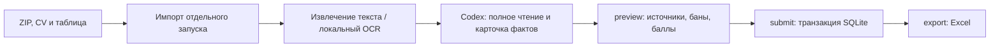

# HR Hive

Переносимая проверка резюме: локальные парсинг и OCR в Docker, семантическая оценка через Codex в VS Code, SQLite и Excel. Работает на macOS (Apple Silicon/Intel) и Windows с Docker Desktop в режиме Linux-контейнеров. Compose выбирает архитектуру автоматически.

[Перенос на Windows](docs/restore-windows.md) · [Изменение критериев и бан-листов](docs/criteria-and-banlists.md) · [Проверки](docs/validation.md)

## Как устроен проект

HR Hive — пакетное Python-приложение с командным интерфейсом. Каждая команда запускает контейнер, выполняет операцию и завершает работу. Данные остаются в подключённом `data/`; веб-сервера и фоновой очереди нет.



**Codex читает резюме и составляет оценку по профилям.** Он находится вне контейнера: получает полные тексты, проверяет все документы и трудовую историю, выбирает подтверждённые специализации и исходные компонентные баллы. Python проверяет карточку, цитаты и ограничения, рассчитывает баны, итоговые баллы и распределение. Самостоятельного автоматического присвоения профессиональных баллов по тексту в движке нет. OCR работает локально через Tesseract, конвертация — через LibreOffice; модель Codex использует авторизацию пользователя, отдельный вызов модельного API в приложении отсутствует.

| Часть | Ответственность |
|---|---|
| `app/cli.py`, `app/service.py` | Команды, версии, закрепление ID, полный показ текста, проверка и сохранение карточек |
| `app/batch.py` | CRC и безопасные пути ZIP, объединение файлов по ID, отдельный scope, хеши и возобновление |
| `app/documents.py`, `app/parallel_extract.py` | Форматы документов, локальный OCR, кэш по SHA-256, полнота страниц и визуальные подтверждения; максимум два процесса |
| `app/engine/` | Профили, профессиональные ограничения, проверка работодателей и банов, ранжирование |
| `app/books.py` | Выгрузка из исходного шаблона с сохранением значений, оформления и ссылок |
| `tools/batch_coordinator.py` | Один координатор SQLite, отдельные полные пакеты и атомарные карточки помощников |
| `app/archives.py`, `tools/transfer_audit.py` | Согласованные SQLite-снимки, SHA-256, паспорт переноса и сверка восстановления |

Исходная шкала профиля: задачи 40, инструменты 30, опыт 20, квалификация 10. Неограниченные требования перераспределяют вес; обязательные профессиональные ограничения проверяются отдельно. Для каждого кластера берётся лучший допустимый профиль; выводятся до трёх кластеров от 60 баллов. «100 Лидеров» требует двух независимых направлений: минимум двух лучших оценок умножается движком на 1,15 один раз до ранжирования, с округлением 0,5 вверх и ограничением 100. При действующем бане рекомендации заменяются на «Бан».

### Состояние и восстановление после остановки

`data/state/active.json` выбирает запуск. В `runs/<run>/inputs/` находится его замороженный набор правил и доказательств; `manifest.json` фиксирует дату оценки и источники, `portable.json` — параметры, хеши и путь выгрузки. SQLite хранит кандидатов, полные тексты, результаты, карточки, интервалы чтения и историю транзакций. История старых версий остаётся доступной.

`claim` возвращает незавершённый пакет того же работника; `show` читается до `next_offset: null`. Проверки блокируют неполное чтение, изменённый оригинал, неподтверждённые страницы и повторное сохранение завершённой оценки. `submit` сохраняет каждого кандидата транзакцией. После пакета выполняется `export`; после сбоя он восстанавливает книгу из SQLite. Файл Excel является выгрузкой, источником сохранённых оценок служит база.

**Одинаковая карточка при одинаковых правилах даёт одинаковый расчёт.** Независимое прочтение моделью может дать другие факты или исходные баллы; это проверяется отдельными аудиторскими карточками, без подгонки и перезаписи результатов.

## Первый запуск на Mac

Установите Git, Docker Desktop для своего процессора, VS Code и расширение Codex. Запустите Docker Desktop и войдите в Codex в VS Code.

Для клонирования приватного репозитория войдите в GitHub через VS Code либо GitHub CLI (`gh auth login`). Если команда `code` не установлена, откройте папку проекта через меню VS Code → File → Open Folder.

```sh
git clone https://github.com/vldsmelov/hr-hive.git
cd hr-hive
mkdir -p data/backups
```

Перенесите **архив данных и файл `.sha256`** в `data/backups/`. CV пока не нужны. Подставьте фактическое имя архива:

```sh
cd data/backups
shasum -a 256 -c hr-hive-transfer.tar.gz.sha256
cd ../..
docker compose build
docker compose run --rm app restore --file /data/backups/hr-hive-transfer.tar.gz
docker compose run --rm app doctor
docker compose run --rm app status --all
docker compose run --rm app export
code .
```

`restore` принимает только пустое хранилище; существующие `cvs` и `backups` допустимы. Проверка всех файлов архива выполняется до записи. Не распаковывайте архив поверх работающей базы вручную.

В чате Codex в VS Code напишите: «Прочитай AGENTS.md, проверь status и продолжи обработку незавершённых резюме». Все правила сохранены в проекте и источниках версии, прежняя переписка не требуется.

## Рабочие каталоги

| Каталог | Содержимое |
|---|---|
| `data/cvs/` | Добавляемые пользователем CV, допускаются вложенные папки; имя без расширения — ID |
| `data/sources/` | Исходная книга, образец, `clusters/*.xlsx`, `banlist/*.csv` |
| `data/state/runs/` | Рабочие SQLite-базы, версии источников, карточки и журналы |
| `data/state/history/` | Архив прежнего проекта и всех запусков; старые скрипты не запускать |
| `data/exports/` | Excel и предыдущие проверенные версии |
| `data/backups/` | Переносимые архивы и контрольные суммы |

Исходные данные находятся только в локальном архиве, в GitHub их нет. SQLite-архивы не содержат бинарных копий CV; полные извлечённые тексты и история сохранены. Отсутствие исходных CV не отменяет уже завершённые проверки. После добавления CV повторно используется хеш содержимого, поэтому перенос в другую папку или Unicode-форма имени на Mac не меняют результат.

## Обычная работа

```sh
docker compose run --rm app scan
docker compose run --rm app extract
docker compose run --rm app retry --ids 123 456
docker compose run --rm app claim --worker codex --count 5
docker compose run --rm app show --id 123 --offset 0 --limit 10000
docker compose run --rm app profiles
docker compose run --rm app preview --file /data/state/cards/123.jsonl
docker compose run --rm app submit --file /data/state/cards/123.jsonl
docker compose run --rm app export
```

Для выбора другого сохранённого запуска: `docker compose run --rm app use --run ИМЯ_ИЗ_STATUS`. Активный запуск после переноса — последняя отдельная папка CV; основная база также доступна через `status --all`.

Параметры `--worker` в claim/preview/submit должны совпадать. Показ текста возвращает `next_offset`; читайте до null. Оценка не выполняется автоматически по ключевым словам. Codex читает документы полностью и составляет карточку; отдельно оплачиваемый модельный API не используется.

Каждый submit сохраняет завершённую проверку транзакцией. Дополнительная автоматическая выгрузка выполняется каждые 25 кандидатов или при первом сохранении после 10 минут с предыдущей выгрузки. После каждого пакета обязательно вызывается `export`. При завершении работы Codex вызывает `export`; после аварийной остановки эта же команда полностью восстанавливает книгу из базы. Между командами нет фонового процесса или таймера.

Книга создаётся из исходного шаблона точечными изменениями XML. Все строки B–AC и их гиперссылки проверяются по исходнику; меняются A, AD–AG. Если файл занят или недоступен, создаётся отдельная версия. Ошибки распознавания сохраняются отдельно от завершённых кандидатов в базе и выводе retry/status.

Для обычного запуска после изменения правил или бан-листов в `data/sources` выполните:

```sh
docker compose run --rm app scan --new-version
```

Старая версия сохранится; новая повторно использует тексты, а решения пересматриваются заново. Новая дата проверки также фиксируется при создании версии, что важно для срочных банов. Не исправляйте снимки критериев внутри существующего запуска. Для архивного запуска используйте новый импорт с `--criteria-dir`, сохраняя состав архива; порядок описан в [инструкции по критериям](docs/criteria-and-banlists.md).

## Резервная копия и обновления

```sh
docker compose run --rm app export
docker compose run --rm app backup --output /data/backups/hr-hive-backup.tar.gz
git pull --ff-only
docker compose build
docker compose run --rm app doctor
```

Архив содержит SQLite-снимки и контрольные суммы каждого файла. Оригиналы CV и их бинарные производные не включаются. Документы правил из `sources/` и `inputs/` сохраняются. Официальные доказательства вне этих каталогов перечисляются с SHA-256 в `state/backup_evidence.json`; их назначение и проверка описаны в инструкции по переносу. Используйте новое имя архива: существующий бэкап не перезаписывается. Для возвращения к прежней копии используйте отдельную пустую папку проекта с тем же кодом.

## Проверки

### Повторяемость сохранённых оценок

Сверка книги с SQLite и три повтора сохранённых карточек выполняются отдельно
от рабочей обработки:

```sh
docker compose run --rm --entrypoint python app -m tools.audit_repeatability --run full_20261016_132123 --reference "/data/exports/Матка №1 — результаты проверки.xlsx" --repeats 3 --report /data/state/repeatability.json
```

По умолчанию выбираются первые завершённые примеры разных категорий результата;
для фиксированной выборки передайте `--ids ID ...`. Каждый повтор выполняет
штатный `preview` в отдельной временной копии базы, с новой Python-сессией и
другим hash seed. Проверяются баллы, порядок кластеров, баны и комментарии.
Рабочие базы, указатель запуска, источники версии и исходная книга проверяются
по хешам до и после. Отчёты JSON и CSV сохраняются локально в `data/state`.

Любое расхождение или ошибка приводит к коду возврата 1. Для отдельного аудита
нового прочтения можно передать `--cards-file /data/state/audit_cards.json`
с массивом вручную проверенных карточек и `--ids ID ...`. Эти карточки не
отправляются в рабочую базу. Повтор одного набора фактов проверяет расчёт;
устойчивость нового семантического разбора проверяется сравнением отдельно
составленных карточек. Совпадение расчёта само по себе её не подтверждает.

```sh
docker compose run --rm -v "$PWD/tests:/tests:ro" --entrypoint python app -m unittest discover -s /tests -v
```

Набор создаёт только синтетические документы. Отчёт проверок перед передачей находится в `docs/validation.md`; локальные отчёты миграции — в `data/state/`.

Приложение поддерживает PDF, DOC/DOCX, DOTX, RTF, изображения, TXT/MD, ODT, PPTX и анкеты XLSX. Pages конвертируется LibreOffice, если конкретная версия формата поддержана; иначе сохраняется явная ошибка. Аудио и незавершённые загрузки автоматически не отмечаются прочитанными. Зашифрованные/повреждённые документы требуют исправленного оригинала.

# Отдельный архив и параллельное чтение

`docker compose run --rm -v "$PWD:/workspace:ro" app import-archive --file /workspace/newCVs.zip --template /workspace/exl1.xlsx --output /data/exports/newCVs_2026-10-22.xlsx`

Импорт проверяет CRC и пути ZIP, группирует все файлы одного ID, создаёт независимый запуск с новыми оценками и снимками действующих правил. Повтор той же команды возобновляет тот же запуск при неизменных архиве, шаблоне, правилах и движке. Прежние результаты не копируются и не меняются. После импорта: `docker compose run --rm app extract --workers 2`, затем обычные `claim`/`show`/`preview`/`submit` и `export`.

Дата нового архива по умолчанию — текущая дата Москвы; для фиксированной проверки
укажите `--as-of YYYY-MM-DD`. Она входит в ключ возобновления и расчёт сроков банов.
Если дата действующего реестра партнёров отличается, импорт остановится до создания
запуска: передайте проверенный пакет через `--partner-registry /data/.../registry.json`.
Старый реестр не передатируется автоматически; ограничения актуальности источников
должны быть явно записаны в новом пакете. Прежние запуски сохраняют свою дату.

Для шаблона из 38 исходных столбцов с ID в A экспорт сохраняет исходные поля и добавляет шесть столбцов результатов. Выгружаются все ID нового запуска, включая ошибки и ожидающие проверки. Прежняя выгрузка из 33 столбцов с ID в B поддерживается отдельно.

При явно разрешённой параллельной работе координатор запускает `docker compose run --rm --entrypoint python app -m tools.batch_coordinator packet --run RUN --worker reviewer-1`. Инструменты входят в образ; дополнительное монтирование кода не требуется. Помощник читает полные JSON-пакеты и правила, записывает по одной карточке в каталог своего worker через атомарное переименование. Только координатор выполняет `save-ready` с теми же RUN и worker: каждую карточку он проверяет через `preview`, сохраняет через `submit` и выгружает Excel. Ни один помощник не открывает SQLite. Для калибровки три помощника независимо читают один пилотный пакет, а координатор сохраняет одну сверенную карточку каждого ID.

### Уточнение строки 262 для архивного запуска

`amend-archive` создает отдельную версию с теми же ID/оригиналами, шаблоном
и датой оценки. Родительские базы, снимки правил, результаты и выгрузка
остаются прежними. Координатор сначала завершает текущие операции, выполняет
`backup` и сохраняет точную копию всех `app/engine/*.py` старой версии.
После изменения кода необходима свежая сборка Docker и проверки:

```sh
docker compose build
docker compose run --rm -v "$PWD/tests:/tests:ro" --entrypoint python app -m unittest discover -s /tests -v
docker compose run --rm app amend-archive --run PARENT_RUN --file /data/state/partner262/registry.json --engine-snapshot /data/state/parent_engine --output /data/exports/newCVs_amendment.xlsx
```

Формат реестра: `schema_version: 1`, `amendment` с `id`, `rule_row: 262`,
`months: 6`, `as_of`, точной `user_instruction`, `approved_by`, `approved_at`,
`approved_domains`; `entities` с `entity_id`, `canonical_name`, точными `aliases`,
`relation: official_partner|resident`, `certainty: confirmed|probable`,
`temporal_basis` и `evidence`. ИНН/ОГРН и `valid_from`/`valid_to` добавляются
только по доказательствам. Каждое доказательство содержит `url`, `title`,
дословный `excerpt`, относительный UTF-8 `snapshot`, его `sha256`, `checked_at`
и `reviewer`. Для производной текстовой выписки сохраняются также исходный
`raw_snapshot` и `raw_sha256`. `supplementary_sources: [{snapshot, sha256}]` сохраняет полный каталог/отчёт
загрузки и остальные официальные страницы, даже не связанные с отдельной записью.
Все перечисленные файлы копируются в frozen
`inputs/amendments/rule262/`; хеш проверяется при оценке. Реестр не делает
сетевых запросов. Подтверждение, полученное позднее даты оценки, сохраняется
с честным временным ограничением и `probable`, без придуманной начальной даты.

Привязка в карточке `employer_relation_evidence` содержит `job_index`,
`entity_id`, `registry_record_sha256` и дословный `source_cv_anchor`.
Хеш записи — SHA-256 канонического JSON (`sort_keys=True`, `ensure_ascii=False`,
`separators=(',', ':')`). Допустима `certainty: probable` для неоднозначной
идентичности/времени.
Совпадение отрасли, клиента, места жительства или общего короткого названия
само по себе привязку не создает. `auto_match` в реестре по умолчанию выключен;
его можно явно включить только для проверенного однозначного полного имени.

В дочернем запуске `migrated_cards/<ID>.jsonl` содержит прежние факты/исходные
баллы с происхождением; все результаты до новой транзакции незавершены.
`amendment_receipt.json` фиксирует старую/новую версии, согласованный снимок
базы, состав архива, источники, хеши фактов и настоящие интервалы чтения.
Интервалы не расширяются автоматически. Подходящие записи реестра, которые
требуют ручного подтверждения, перечислены в receipt у кандидата.
Добавьте только доказанную связь, затем сохраните штатно:

```sh
docker compose run --rm app preview --worker amendment --file /data/state/runs/CHILD_RUN/migrated_cards/ID.jsonl
docker compose run --rm app submit --worker amendment --file /data/state/runs/CHILD_RUN/migrated_cards/ID.jsonl
docker compose run --rm app export
```

Результат новой версии получает новый `rules_hash`, строгий
`implementation_hash` и хеш receipt. Старый хеш не разрешается для нового
движка и не перезаписывается у родителя. Прежние баллы не выдаются за новый
сохраненный результат: `preview` заново выполняет детерминированный расчет
по исходной карточке, `submit` создает новую историю. Неизмененные факты
перенесенной карточки защищены; для содержательных изменений требуется
отдельное новое прочтение. Повтор той же команды возобновляет уже созданную
полную версию, проверяя frozen inputs и архивный scope.
